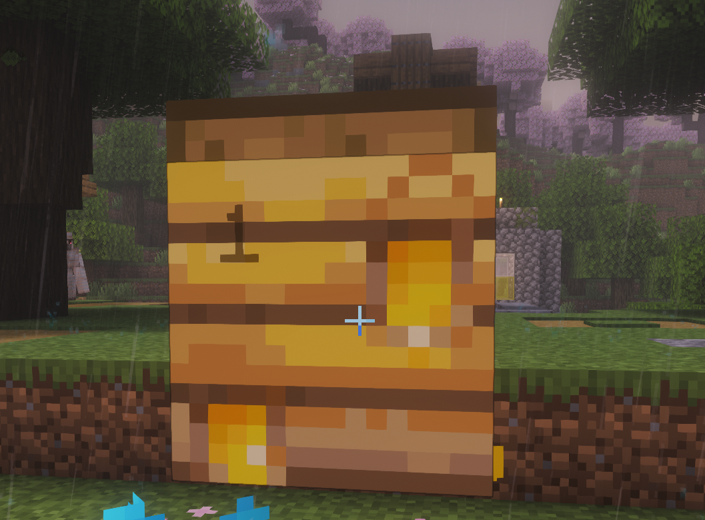

# Hive Peek

A Minecraft data pack that shows how many bees are inside a beehive or bee nest. Look at a hive and a small, faint number appears in the top-left corner of its front.



## Why a data pack?

The game never sends a hive's bee count to players. The server keeps it to itself. Resource packs and client-side mods can't see it on a multiplayer server, and the vanilla tooltip only works on hive items in your inventory.

Hive Peek runs on the server. Players don't install anything, and it works on vanilla, Paper and Fabric servers, and in singleplayer worlds.

## How it works

- Every tick, it checks which block each player is looking at, using their normal reach (4.5 blocks in survival, 5 in creative).
- If that block is a beehive or bee nest, a small label shows the number of bees inside, from 0 to 3.
- The number updates as bees fly in and out. It disappears when you look away.
- It doesn't see through blocks. A wall between you and the hive means no label.

## Install

1. Download the latest `hive-peek-<version>.zip` from the releases page.
2. Put the zip in your world's `datapacks` folder. On a server that's `world/datapacks/`. In singleplayer, open the world's folder from **Edit > Open World Folder**.
3. Run `/reload`. On Paper servers, run `/minecraft:reload` instead, because plain `/reload` reloads plugins there. Or just restart the server.

## Uninstall

1. Run `/function hive_peek:uninstall` to remove any labels and the scoreboard.
2. Delete the zip from the `datapacks` folder.

## Supported versions

Minecraft Java Edition **1.21.9 to 26.3**. The automated tests run on 1.21.9, 1.21.11, 26.1.2, 26.2 and 26.3, one version for each data pack format in that range.

## Good to know

- **Everyone sees the label.** Labels are real text display entities, so nearby players can also see the number on a hive someone else is looking at. Data packs can't show something to one player only.
- **One hive at a time per player.** Only the hive in each player's crosshair gets a label.
- **The labels are temporary.** Each label is removed as soon as nobody is looking at that hive. If the server stops while one is showing, it is cleaned up the next time the pack loads.
- **The cost is small.** Each player's check is a short line trace of up to 50 block checks per tick.

## Development

The pack source is in `datapack/`.

Build a release zip (needs Node 22+):

```sh
node build.js 1.0.0
```

Run the tests (needs Node 22+ and Java 25):

```sh
node test/run.js 26.3 26.2 26.1.2 1.21.11 1.21.9
```

The test runner downloads each vanilla server from Mojang, starts it with a fresh empty world and the pack installed, and drives it over RCON. An armor stand stands in for a player. Set `JAVA` to use a specific Java binary.

To change where the number sits, edit the offsets in `datapack/data/hive_peek/function/label/at_hive.mcfunction`. The color is in `label/update.mcfunction`, and the faintness (`text_opacity`) is in `label/show.mcfunction`.

## License

[MIT](LICENSE)
